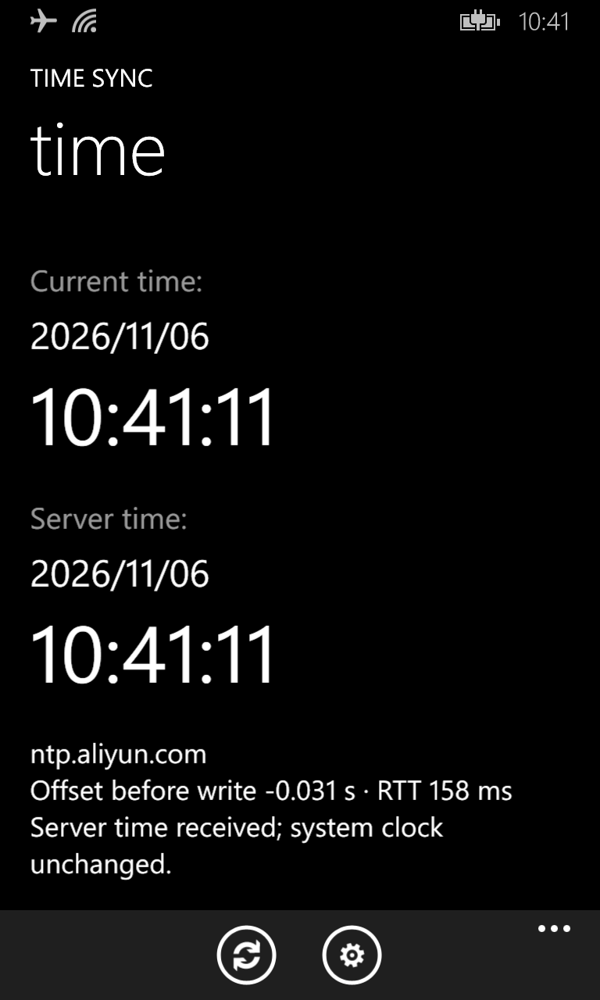
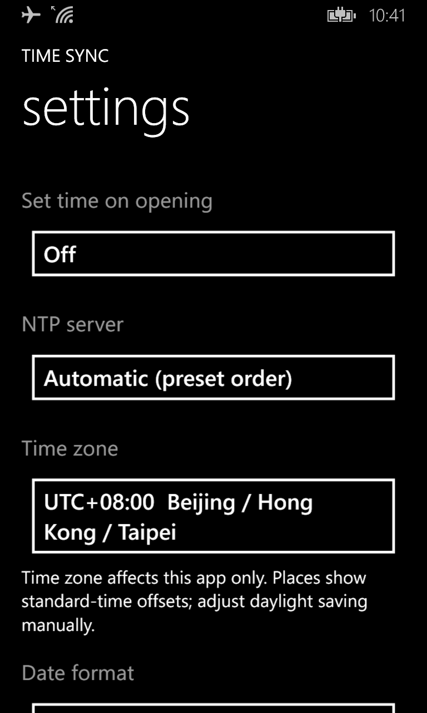
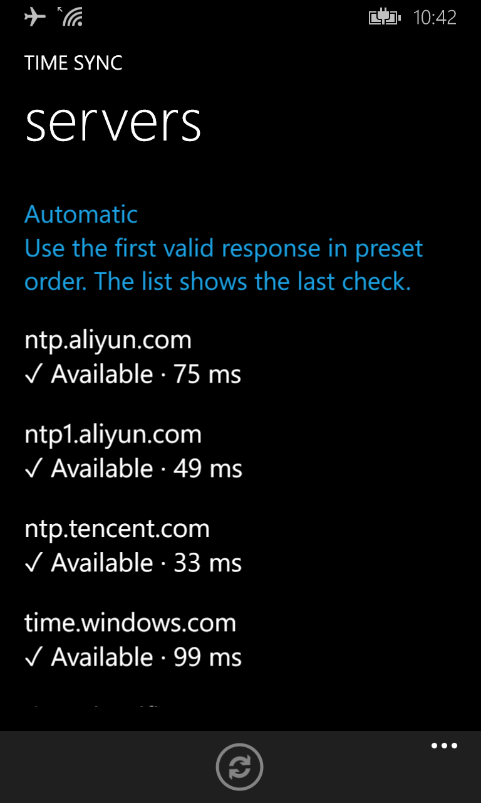

<p align="center"></p>

# 校时 / Time Sync

A network time synchronization app for Windows Phone.

**Current version: 0.6.1 · Experimental**

English | [简体中文](README.zh-CN.md)

## Screenshots

Captured on a Lumia 920T running Windows Phone 8.1, with the English interface.

| Main screen | Settings | Servers |
| --- | --- | --- |
|  |  |  |

The main-screen example shows a successful time query without a system clock write. Availability and delays reflect the network conditions at the time of capture.

## Overview

Time Sync obtains network time over NTP and displays the phone's current time, server time, offset before correction, and round-trip delay. On a device with suitable system access, it can attempt to set the system clock and verify the result by reading it back.

The interface follows Windows Phone styling, keeps the system tray visible, and supports transparent tiles. Its name is “校时” in Simplified Chinese, “校時” in Traditional Chinese, and “Time Sync” in other languages.

## Compatibility and permissions

- Targets Windows Phone 8.0 Silverlight and is installed by sideloading an XAP package.
- Device feedback is available for the Lumia 920T running Windows Phone 8.1, OS version 8.10.12393.890.
- Windows Phone 8.0, other WP8.1 devices, and Windows 10 Mobile have not received comprehensive device testing; compatibility is not guaranteed.
- Fetching network time does not imply permission to change the system clock. Developer unlocking, XAP sideloading, and bootloader unlocking alone do not guarantee clock-writing access.
- The app does not obtain Root or elevate privileges. Actual access depends on the device's existing permissions and system modifications. The API result and read-back check are the relevant evidence.

## Features

- Current and server time displayed to the second.
- NTP offset and round-trip delay.
- Ordered automatic server fallback or a fixed manually selected server.
- Recent server availability and delay indicators.
- Manual synchronization and an option to set time when opening the app.
- Display time zone, date formats, system-language matching, and manual language selection.
- Read-back verification, error codes, application error records, and recovery notices after an unfinished clock write.

**Automatic setting operates while the app is in the foreground; it is not a background service or scheduled task.** Check the setting on first use and after recovery. This version includes protection that disables automatic writing on its first initialization.

## Installation and use

1. Install version 0.6.1 using an appropriate Windows Phone XAP deployment tool. Updating normally retains settings; uninstalling removes application data.
2. Connect to a network that permits NTP traffic. The current client uses IPv4 and UDP port 123.
3. Check the server, display time zone, and date format. Explicitly enable “Set time on opening” if automatic writing is desired.
4. Tap the synchronization button on the main screen. “Set system time” in the application menu also fetches a new sample and attempts a write.
5. Read the result. Success is reported only after the system clock passes read-back verification.

If fetching time succeeds but writing fails, the server time can still be used as a reference. Samples are refreshed as needed when returning to the main page. The displayed server clock is extrapolated from the most recent valid sample; the app does not send a new request every second.

## NTP servers

Automatic mode tries these servers in order and **uses the first valid response, rather than choosing the lowest delay or averaging multiple sources**:

1. `ntp.aliyun.com`
2. `ntp1.aliyun.com`
3. `ntp.tencent.com`
4. `time.windows.com`
5. `time.cloudflare.com`
6. `time.google.com`
7. `time.aws.com`
8. `time.nist.gov`

Each request has an approximately four-second timeout. Automatic mode advances after a timeout, DNS/network failure, or invalid response. Manual mode does not silently switch servers. If all requests fail, no failed response is used to set the clock.

The list shows “Not checked,” “Checking,” “✓ Available · 53 ms,” or an unavailable status with a reason. Delay is calculated from NTP exchanges, not ICMP ping. Results reflect the most recent check and do not guarantee ongoing availability. Checking the server list does not write the system clock.

Updates retain the previous server selection. Select “Automatic” explicitly if you want to switch to ordered fallback.

## Time zone, date, and language

**The time-zone setting in 0.6.1 affects only the app's display. It does not change the phone's system time zone.** Clock correction writes UTC. The status bar and other applications continue to use the system time zone.

The app uses fixed UTC offsets, defaulting to UTC+08:00, with choices from UTC−12:00 to UTC+14:00. Place names are references for standard offsets, not full regional rules. **Automatic daylight saving time is not implemented; adjust the display offset manually.**

Date formats: `YYYY/MM/DD`, `YYYY-MM-DD`, `DD/MM/YYYY`, and `MM/DD/YYYY`. Time uses the 24-hour `HH:MM:SS` format.

There are 15 interface languages: Simplified Chinese, Traditional Chinese, English, Spanish, French, Portuguese, Russian, German, Japanese, Indonesian, Hindi, Arabic, Korean, Vietnamese, and Turkish.

The default is to follow the system language, falling back to English for unsupported languages. Manual selection overrides it and takes effect after fully closing and restarting the app. The launcher name follows the system language independently. Arabic uses right-to-left layout while numeric clocks and server addresses remain left-to-right. Original system exception text and error codes are retained for diagnostics.

## Limitations and troubleshooting

- Error `5` or `1314`: access denied or a required clock privilege is missing. Sideloading capability alone does not establish write access.
- Error `126` or `127`: a required system module or entry point is unavailable.
- A successful API return followed by failed read-back verification is not reported as a successful clock correction.
- Open “…” → “Result / diagnostics” on the main page to view the latest result and recorded application errors.
- Version 0.6.1 fixes the missing server-page resource. Device feedback confirms that the menu opens and multilingual display checks pass. Translations have not all received native-speaker review.
- A suspected status-bar freeze after clock correction remains unconfirmed and needs reproduction.
- The native writer currently accepts target years 2020–2099. This does not guarantee full NTP support for that range: timestamp parsing does not implement NTP era unfolding across the 2036 rollover.
- NTP responses are not cryptographically authenticated. Packet validation does not authenticate the server's identity.

System time-zone writing is being investigated separately in **TimeZone Probe** and is not integrated into this release. Diagnostic read-only and same-value-write packages are not features of the main app.

## Data and networking

The app performs DNS/NTP communication with selected or automatically attempted servers, which can see the connection's source address. Settings and diagnostic records are stored in application isolated storage. The current source contains no account system, advertising, analytics, or automatic diagnostic-log uploads.

## Source and building

| Path                                             | Purpose                                             |
| ------------------------------------------------ | --------------------------------------------------- |
| `TimeSync.csproj`                                | Windows Phone Silverlight project                   |
| `Pages.cs`, `ServerPage.cs`                      | Pages, settings, and server list                    |
| `Ntp.cs`, `Servers.cs`                           | NTP packets, requests, status, and ordered fallback |
| `ClockWriter.cs`                                 | Clock writes and read-back verification             |
| `Native/ClockNative.c`, `Native/ClockNative.idl` | Native WinRT bridge and interface                   |
| `Loc.cs`, `Localization/Strings.tsv`             | Language resolution and translations                |
| `Tests/`                                         | Server and localization checks                      |

Building requires the Windows Phone 8.0 SDK and relevant .NET build tools. The current build also uses WP8.1 SDK XAML compilation tasks. Rebuilding the native code requires the toolchain referenced by `Native/Build-Native.ps1`.

```powershell
MSBuild.exe TimeSync.csproj /t:Rebuild /p:Configuration=Release /p:Use81XamlCompiler=true
```

The output is `bin/Release/TimeSync.xap`. Keep managed code **AnyCPU/MSIL** and the native DLL **ARM**. Do not change the managed target to ARM just to suppress the architecture warning. Declare pages and resources before importing the SDK targets to ensure they are packaged.

Version 0.6.1 passed build, page-resource, server-selection, and localization checks, along with MDIL deployment optimization using both SDK 8.0 and 8.1. Automated and mocked tests do not replace device compatibility or effective-permission testing.

## License

The project source code is licensed under the [Mozilla Public License 2.0 (MPL-2.0)](LICENSE). See the license for the full terms.
