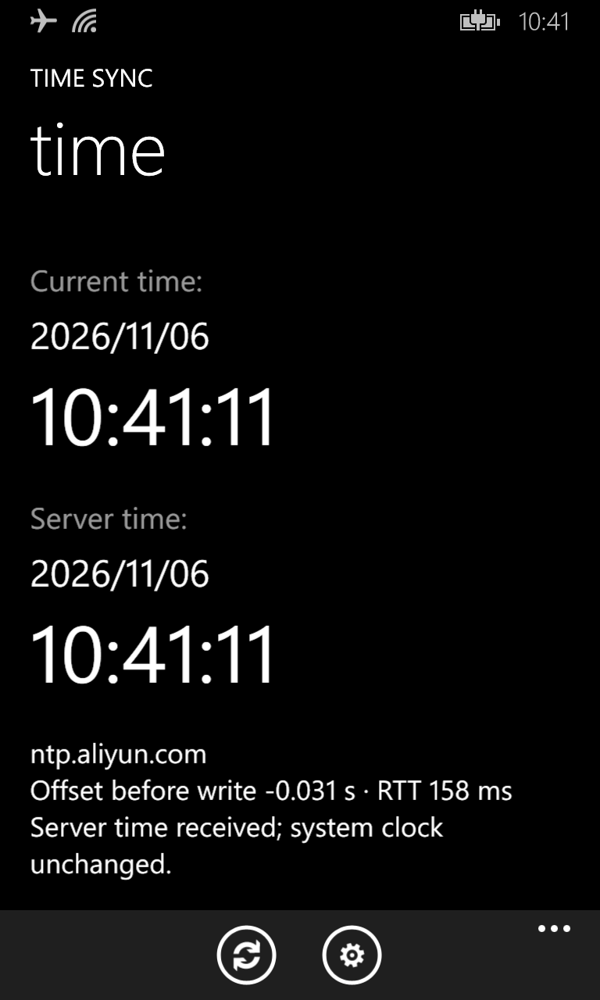
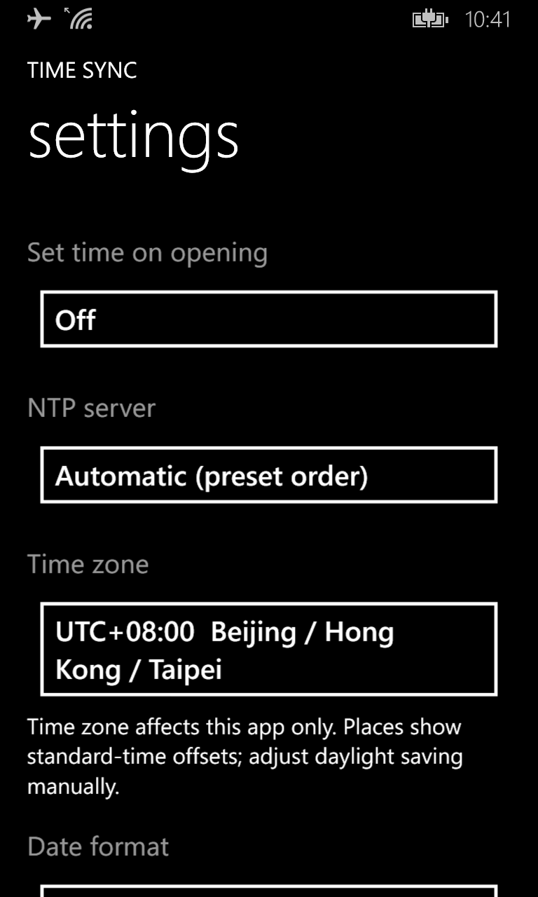
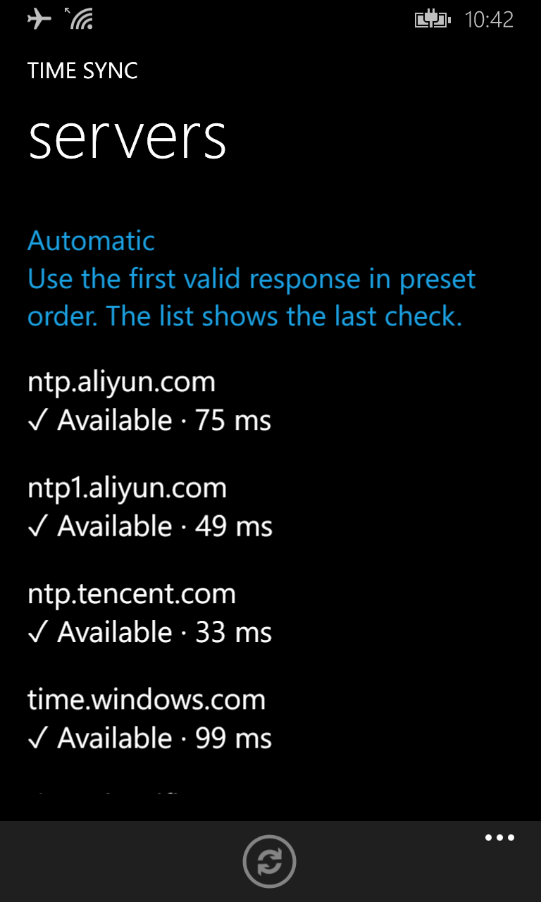

<p align="center"></p>

# 校时 / Time Sync

适用于 Windows Phone 的网络校时工具。

**当前版本：0.6.1 · 测试版**

简体中文 | [English](README.md)

## 界面截图

以下为 Lumia 920T / Windows Phone 8.1 真机截图，界面语言为英文。

| 主界面 | 设置 | 服务器列表 |
| --- | --- | --- |
|  |  |  |

主界面示例展示成功取时、未写入系统时间的状态。服务器可用性及延迟仅代表截图时的网络检测结果。

## 简介

“校时 / Time Sync”通过 NTP 获取网络时间，显示手机当前时间、服务器时间、校时前偏差和网络往返延迟。在具备相应系统访问条件的设备上，可尝试校准手机系统时间，并回读确认结果。

界面参照 Windows Phone 系统样式，保留状态栏，支持透明磁贴。简体中文名称为“校时”，繁体中文为“校時”，其他语言环境为“Time Sync”。

## 兼容性与权限

- 项目以 Windows Phone 8.0 Silverlight 为目标，使用 XAP 侧载安装。
- 已有真机反馈来自 Lumia 920T，Windows Phone 8.1，系统版本 8.10.12393.890。
- Windows Phone 8.0、其他 WP8.1 设备及 Windows 10 Mobile 尚未完成全面真机验证，不能保证全部兼容。
- 联网取时与显示时间不等于拥有系统校时权限。开发者解锁、可侧载 XAP 或 Bootloader 解锁，本身均不能保证应用能够写入系统时间。
- 应用不会自动获取 Root 或提升权限。写入是否成功，取决于设备当前的系统权限及修改状态；以实际接口返回和回读结果为准。

## 功能

- 以秒为单位显示当前时间与服务器时间。
- 使用 NTP 查询，显示校时前偏差与往返延迟。
- 按预设顺序自动尝试服务器，或手动固定一台服务器。
- 显示服务器最近检测状态及延迟。
- 手动校时，以及“进入程序后自动校时”设置。
- 显示时区、日期格式、跟随系统语言与手动语言选择。
- 校时回读验证、错误码、应用错误记录，以及未正常结束的写入恢复提示。

**“自动校时”指应用在前台按设置尝试校时，不是后台常驻服务或定时任务。** 首次使用及异常恢复后请检查该开关；本版包含将首次自动写入关闭的保护逻辑。

## 安装与使用

1. 使用适用于设备的 Windows Phone XAP 部署工具安装 0.6.1。覆盖更新通常保留应用设置；卸载会丢失应用数据。
2. 连接可访问 NTP 服务的网络。当前客户端使用 IPv4、UDP 123 端口。
3. 打开设置，确认服务器、显示时区和日期格式；如需自动写入，明确开启“进入程序后自动校时”。
4. 返回主界面，点击底部校时按钮。菜单中的“校准系统时间”同样会重新取时并尝试写入。
5. 查看操作结果。只有实际回读通过，才显示系统时间校准成功。

取时成功但写入失败时，应用仍可显示服务器参考时间。返回主界面时会按需刷新样本；界面内的服务器时间由最近一次有效样本加经过时间推算，并非每秒重新请求服务器。

## NTP 服务器

自动模式按以下顺序尝试，**采用首个有效响应，不按延迟排序，也不对多台服务器取平均**：

| 顺序 | 地址 |
| --- | --- |
| 1 | `ntp.aliyun.com` |
| 2 | `ntp1.aliyun.com` |
| 3 | `ntp.tencent.com` |
| 4 | `time.windows.com` |
| 5 | `time.cloudflare.com` |
| 6 | `time.google.com` |
| 7 | `time.aws.com` |
| 8 | `time.nist.gov` |

单次请求超时约 4 秒。超时、网络或 DNS 错误、响应校验失败后，自动模式继续尝试下一台；手动模式失败时不自动切换。全部失败时不会使用失败响应写入系统时间。

服务器列表显示“未检测”“检测中”“✓ 可用 · 53 ms”或“× 不可用 · 原因”。延迟来自 NTP 请求计算，不是 ICMP Ping。结果只代表最近一次检测；可手动重新检测，不保证持续可用。进入列表检测不会写入系统时间。

覆盖更新会保留原服务器选择；如需自动模式，请在设置中选择“自动选择”。

## 时区、日期与语言

**0.6.1 中的时区选项只影响应用显示，不修改手机系统时区。** 系统校时写入 UTC；手机状态栏及其他应用的本地时间仍由系统时区决定。

当前采用固定 UTC 偏移，默认 UTC+08:00，范围 UTC−12:00 至 UTC+14:00。地点名称仅作为标准偏移的参考，不代表完整地区规则。**夏令时尚未自动处理，需要手动调整显示偏移。**

日期格式支持 `YYYY/MM/DD`、`YYYY-MM-DD`、`DD/MM/YYYY`、`MM/DD/YYYY`；时间采用 `HH:MM:SS` 的 24 小时制。

支持 15 种界面语言：

简体中文、繁體中文、English、Español、Français、Português、Русский、Deutsch、日本語、Bahasa Indonesia、हिन्दी、العربية、한국어、Tiếng Việt、Türkçe。

首次默认跟随系统；不支持的系统语言回退英文。支持手动覆盖，修改后需完全退出并重启应用。启动器名称跟随系统语言，独立于应用内手动语言选择。阿拉伯语界面采用从右向左布局，数字时间与服务器地址保持从左向右。底层异常原文与错误码保留用于排错。

## 限制与故障排查

- 错误 `5` 或 `1314`：系统拒绝写入或缺少相应校时权限。不能仅凭是否可侧载来判断权限。
- 错误 `126` 或 `127`：未找到所需系统模块或接口。
- “接口返回成功，但回读校验未通过”：不视为校时成功，请保留结果用于排查。
- 可通过主界面“…”→“校时结果 / 诊断”查看最近结果及已记录的应用错误。
- 0.6.1 已修复服务器页面资源缺失问题，已收到服务器菜单正常打开及多语言显示检查通过的真机反馈。尚未经所有语种母语者审校。
- 校时后状态栏疑似停滞仍为待复现问题，原因未确认。
- 原生时间写入参数目前限制目标年份为 2020—2099；这不是完整的 NTP 年份支持保证。当前 NTP 时间戳解析未实现 2036 年纪元回绕展开，不能宣称可靠支持该回绕之后的授时。
- 普通 NTP 响应未做加密认证；报文有效性校验不等于可信来源身份认证。

系统时区写入仅在独立的 **TimeZone Probe / 时区诊断** 中研究，未集成到本版。只读、原值写入等诊断包不属于主程序的正式功能。

## 数据与网络

应用使用所选或自动尝试的服务器进行 DNS/NTP 通信；服务器可见网络连接的来源地址。设置与诊断记录保存在应用隔离存储中。当前源码未包含账号系统、广告、分析统计或自动上传诊断日志的功能。

## 源码与构建

主要文件：

| 路径 | 用途 |
| --- | --- |
| `TimeSync.csproj` | Windows Phone Silverlight 项目 |
| `Pages.cs`、`ServerPage.cs` | 页面、设置和服务器列表 |
| `Ntp.cs`、`Servers.cs` | NTP 报文、查询、状态和顺序切换 |
| `ClockWriter.cs` | 系统校时调用与回读验证 |
| `Native/ClockNative.c`、`Native/ClockNative.idl` | 原生 WinRT 桥接及接口定义 |
| `Loc.cs`、`Localization/Strings.tsv` | 语言匹配与翻译资源 |
| `Tests/` | 服务器及本地化检查 |

构建环境需要 Windows Phone 8.0 SDK 及相关 .NET 构建工具。当前构建方案另用 WP8.1 SDK 的 XAML 编译任务；原生源码重编译还需要 `Native/Build-Native.ps1` 所使用的工具链。

```powershell
MSBuild.exe TimeSync.csproj /t:Rebuild /p:Configuration=Release /p:Use81XamlCompiler=true
```

输出为 `bin/Release/TimeSync.xap`。托管部分保持 **AnyCPU/MSIL**，原生 DLL 为 **ARM**；不要为了消除架构警告而将托管目标改为 ARM。页面与资源声明须放在 SDK targets 导入之前，避免漏打包。

0.6.1 已通过构建、页面资源检查、服务器选择及本地化测试，以及 SDK 8.0／8.1 的 MDIL 部署优化检查。自动化与模拟测试不替代真机兼容性和实际权限验证。

## 许可证

本项目源码采用 [Mozilla Public License 2.0（MPL-2.0）](LICENSE) 许可，完整条款请参阅许可证文件。


